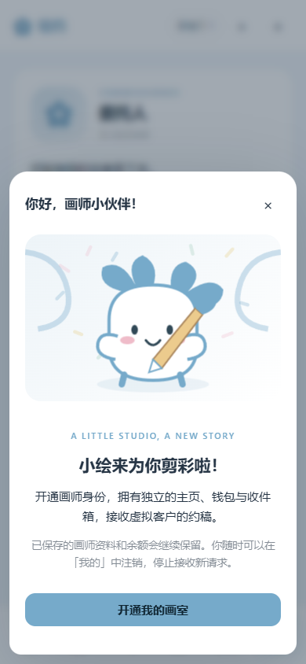

# 绘约 · SillyTavern 约稿扩展 v1.5.0

面向手机竖屏的虚拟约稿平台。六个页面是「橱窗、稿拍、广场、消息、工作台、我的」。所有交易使用虚拟绘币，初始甲方账户赠送 10,000 绘币，不接真实支付。

代码按 SillyTavern 官方 release 1.19.0 的 getContext、generateRaw、消息事件与 Image Generation 命令接口制作。不需要酒馆助手、Node 依赖安装或构建。已做浏览器端功能测试和酒馆接口模拟测试，尚未在用户实际酒馆安装中联调，也未接入真实计费模型验证。

## v1.5.0 · 生图预设、角色私信与企划回复

更新仍使用原仓库：<https://github.com/yuh123776-cyber/->。在酒馆扩展管理中更新并刷新，确认打开入口显示 **v1.5.0**。无需重新安装或清空存档；保留 API 配置库、密钥、既有订单、角色资料与原图。

### 生图规则与预设

「我的 → 设置、AI 接口与存档」顶部新增三个分类按钮：**接口与存档 / 生图规则与预设 / 私信与剧情互动**。

- 正向、负向分别决定使用哪份预设：**草稿专用非空 → 画师单独非空 → 全局默认**。草稿专用只影响草稿阶段；画师和单张稿件仍可单独编辑。既有稿件的提示词不随全局设置改变。
- 提示词 AI 的附加指令、生成规范、自填思维链 / 推理提示及发送位置，生图 AI 的附加指令、规范、推理提示及位置，集中在「生图规则与预设」。图片服务的这些文本会拼入正向提示词；实际请求保存在生成参数中。这些字段用于自填指令，不读取模型内部隐藏推理。
- 每张稿件新增「重 roll」和「修改 / 重绘」。重 roll 或空白修改保留本版正反向词，只随机新种子，**不调用提示词模型**；有修改意见时，提示词 AI 基于原版重写相关部分并使用新种子，然后绘制。两种操作都会请求生图服务，费用取决于所选服务。
- 原图始终保留，新结果作为新版本。对已结束订单或旧阶段重绘不会推进当前验收阶段；有内容的当前阶段修改遵循约定修改次数，单纯换种子不消耗修改次数。
- 「我的 → 我的稿件」收录订单的生成图片、上传稿件及赠图，可查看、下载、修改、重绘，并区分甲方与画师身份。

### 私信、头像与气泡

- 新默认对话预设优先读人物、user 人设、已关联角色、关系和近期剧情；ACGN / OC 表达与 meme 按人物习惯少量使用，不要求人人同一种口癖。旧内置默认预设自动升级，用户自行修改过的预设保留，可在互动设置恢复新版。
- 画师身份的客户明确作为甲方发言，私信不继承旧通用模板中“你是画师”的身份指令；继续按联系人隔离聊天与订单。
- 「私信与剧情互动 → 甲方头像库」可上传多个头像、为未设置头像的客户分配。私信右上角可单独编辑甲方人设、性格及专属头像；未设头像时显示独立文字头像，不套用玩家头像。私信两边均显示头像。
- 「聊天头像与气泡」内置柔和、圆润、描边、便签、像素等样式，可调双方颜色、圆角和聊天范围内的 CSS。按身份分别保存，启用共用美化时共用。
- 关联角色资料和相关世界书会进入画师的私信与报价判断。画师可基于关系自愿降价或赠图；具体方案进入待确认订单，既有付款不会被对话擅自改动。赠图以独立零价稿件记录，由用户自行生成或上传，不自动发起额外生图请求。

### 企划应征与用途定价

- 邀请送达后先显示“等待答复”。AI 模式按性格、关系、排期、授权价格规划答复时间、接受或拒绝、理由和第一条私信；预设模式按人设关键词决定等待时间并从条目选回复。可等真实时间或推进剧情日；回复计划持久保存，定时器不会重复请求模型。
- 统一在「私信与剧情互动」选择 **AI / 内置或自定义条目**，同时控制答复时间、企划决定、拒绝理由、首条私信和甲方开场；拒绝理由与开场条目可自行编辑。默认使用条目，切换 AI 后使用当前绘约私信服务配置。
- 正文中已关联角色明确作出的企划答复优先于定时计划。AI 模式提取明确决定，条目模式识别明确答应 / 拒绝语句；没有可确定归属或决定时不擅自接受。正文更新可以覆盖此前答复，重复渲染不重复落地。
- 画师接受后先发私信，不会自动创建或扣款；甲方可再点击“基于应征发起委托”确认需求与最终报价。
- 编辑画师或自己的画师资料，可按行填写 `商用 * 2`、`印刷 * 1.5`、`vup * 3`、`买断 * 3`、`工程文件 * 1.5`、`某IP同人打95折`。每位画师可有不同倍率；AI 创建画师也可按人设生成规则。用途倍率叠加，匹配的同人折扣取一条，关系优惠另行计算。
- 委托表单区分基础价和实际总报价，显示规则价并可一键填写。勾选用途或需求中明确提到用途时应用规则，仅带基础价但不足以覆盖授权时会拒绝；AI 也可按人物偏好拒绝。优惠实际反映在确认付款金额，已经填过优惠价时不重复打折。
- 重画稿拍锤子 SVG，底部选中导航图标增加填色与线条变化；除主动触发剧情的按钮外，移除界面“模拟”文本。

本版通过 59 项逻辑测试、30 个脚本语法检查，以及手机尺寸 Chrome 的生图、角色私信、企划、气泡与旧接口配置回归。模型与图片返回均为测试数据，没有调用收费服务；仍需在实际手机酒馆里确认服务与主题兼容。

## v1.4.0 · 记住密钥与多套 API 配置

每类服务（私信与人物生成、提示词 AI、生图）现在都有自己的「已保存的 API」列表，可保存多套配置。

1. 首次填写 URL 和密钥，拉取模型并选择；配置名称可留空，插件会自动命名。
2. 点击「保存设置」。插件保存本次 API 的名称、URL、模型、自动识别结果及密钥，刷新页面或重新打开浏览器后仍可使用，不必重新输入。
3. 要添加备用 API，点击该服务下的「新增配置」，填写新的连接并保存。原配置会继续保留。
4. 切换时，从「已保存的 API」选择一个配置，再点击「保存设置」；URL、模型、调用方式和对应密钥会一起恢复。
5. 已有配置可以改名、修改地址、替换密钥或更换模型，保存时更新原配置。Key 留空保留原密钥；要移除密钥请点击「清除密钥」。点击「删除配置」会一并删除该配置的密钥。

配置库保存在当前浏览器的本地数据库，由该浏览器里的绘约世界共享；三类服务各自选择配置。普通剧情存档、生成参数和图片导出不包含配置库中的密钥。配置库不会跨设备同步，清除浏览器网站数据会移除它。

密码框不回填密钥原文，会以「已保存；留空保留」提示。新增 API 不继承其他配置的密钥；URL 改为不同站点时也不会沿用原密钥。私信、提示词和生图的密钥互相隔离。

升级会保留已有剧情存档和原图。以前只在内存中填写的密钥需要在新版保存一次，此后就能记住。界面继续使用简洁的 URL、密钥和模型选择流程，接口兼容由插件处理。

## v1.3.1 · URL + 密钥，自动兼容

打开「我的 → 设置、AI 接口与存档」。私信、提示词 AI、绘图服务均使用相同流程：

1. 填写站点 URL 和该站 API Key。填写 URL 会自动选择独立 API 调用。
2. 点击「拉取模型并连接」。插件自动匹配协议、模型列表路径、生图路径与默认参数。
3. 在唯一的「模型」下拉框选择模型，点击「保存设置」。

不需要选择站点预设、协议、鉴权方式、接口路径或填写 JSON；界面没有高级兼容设置。原有存档和已经保存的模型继续保留，密钥保存在当前浏览器的 API 配置库，普通存档不含密钥。

### 自动识别范围

| 输入的站点 URL | 用途 | 插件自动处理 |
| --- | --- | --- |
| `https://tang.iisbo.com/novelai` 或域名 | 生图 | NAI 原生参数，`/novelai` 路径前缀，ZIP/JSON 图片 |
| `https://api.rinko.ai/nai` | 生图 | NAI 原生参数，`/nai` 路径前缀 |
| `https://ynai.rinko.ai/` | 生图 | YesNovelAI 原生请求体和 JSON 图片返回 |
| `https://nai.rinko.ai/` | 生图 | YesNovelAI 原生请求体和 JSON 图片返回 |
| `https://api.rinko.ai/v1` 或域名 | 私信、提示词 | OpenAI 兼容文本；按模型元信息识别 Responses |
| `https://gcli.ggchan.dev/` | 私信、提示词 | OpenAI 兼容文本 |

绘图服务填写 Rinko 纯域名时默认识别为 NAI；明确填写 `/v1` 则使用其 OpenAI 兼容图片接口。站点识别使用精确域名匹配，不会把密钥发送到相似域名或跳转目标。

其他兼容站点自动规范化常见 URL，并在同一站点内以 GET 尝试最多三个常见模型列表路径。站点提供模型能力元信息时，插件按信息选择 Chat、Responses、Images 或聊天式生图；没有元信息时使用通用兼容协议。不同模型的接口配置会跟随下拉选择切换并随设置保存。

### 连接状态说明

- 成功读取模型列表表示模型发现成功，不代表已经执行收费生图/文本生成。自动识别只读取模型列表，不会自动提交生成或重试收费任务。
- 密钥错误、权限不足和限流会直接提示，不轮流尝试其他接口。改 URL 或密钥会取消旧请求，旧返回不能覆盖新设置。
- 某些 NAI 服务没有模型列表接口。此时插件仍能匹配其 NAI 协议，并提供明确标注的常用参考模型，同时提示「连接尚未验证」；不会把本地列表伪装成成功拉取。
- 如果未知站点使用非标准私有协议、不同鉴权机制、禁止跨域或不提供可识别信息，插件会显示连接失败。仅凭 URL/密钥无法保证推断任意私有 API，后续应由插件增加适配，无需用户填写兼容参数。
- 旧版手动配置字段作为内部连接数据保留，升级不会删除已经可用的连接。重新拉取或更换 URL 时改为自动识别配置。

生图仍支持 NAI 正反向词、种子、步数、CFG、ZIP/JSON 原图，标准 Images 和聊天式图片返回；图像尺寸等创作选项继续保留。没有加入通用参考图、局部重绘或专用异步任务协议。验证使用模拟生成响应，未使用用户真实密钥或调用收费模型。

## v1.2.2 · API 模型列表选择

在「我的 → 设置、AI 接口与存档」的私信与人物生成、提示词 AI、绘图服务三处配置中，选择「独立 OpenAI 兼容接口」，填写 API 根地址（含 /v1）和 Key，点击「拉取模型列表」。在「可用模型」下拉框选择后点击「保存设置」。也可继续手动填写模型名。

- 拉取使用当前表单里的地址和 Key，无需提前保存；Key 留空时使用当前页面已保存的对应服务 Key。拉取本身不会保存 Key 或改动其他未保存设置。
- 向根地址追加 `/models`，以 Bearer Key 请求。支持标准 `{data:[{id:...}]}`，以及数组、`{models:[...]}` 中的字符串或 id 对象，自动去重排序。
- 服务返回的列表可能同时含文本和图片模型，请按用途选择。空列表、权限错误、格式错误、跨域/网络失败和 20 秒超时会显示提示；失败保留原模型名，仍可手动填写。
- 修改调用方式、地址或 Key 会清空旧列表并取消旧请求，迟到结果不会覆盖新配置。三个配置独立拉取，模型列表不写入存档，所选模型随正常设置保存。
- 酒馆模式沿用酒馆主界面或图片扩展的模型选择；自定义图片适配器使用自己的协议，保留手动模型名。按钮在这两种模式下禁用。
- 服务必须支持模型列表端点并允许浏览器跨域请求。本版本已通过模拟接口测试，未连接真实服务或产生模型费用。

## v1.2.1 · 客户一对一私信与手机拖动兼容

- 每位模拟客户有独立联系人标识、收件箱与聊天历史。同一位客户再次委托会延续自己的会话；其他客户不会混入。
- 客户订单中的「打开私信」、交稿、修改版与修改意见都按客户归属进入对应会话。发给 AI 的上下文只包含该客户的资料、当前身份下的聊天与该客户的订单；生成任务也按身份和联系人隔离。
- 旧版「客户咨询」中的消息会按订单号、稿件版本或明确客户名前缀迁移。不能确认归属的旧消息保留在「旧版未归属客户记录」中，只读查阅，不再作为任何客户的 AI 上下文。原图引用和消息内容保留。
- 拖动处理改为先于宿主页面事件的窗口捕获，并单独处理手机 Touch Events；触摸拖动不依赖后续鼠标点击事件，轻触由程序打开。入口强制保留禁止页面平移的触摸属性，避免酒馆或主题样式覆盖后把手势变成页面滚动。

更新刷新后，扩展设置按钮应显示 v1.2.1；按住图标直接移动即可。仍需在你的实际手机上确认显示和手势效果。

## v1.2.0 · 拖动悬浮入口与聊天表情包

- 悬浮图标现在支持鼠标和手机触摸拖动。轻点打开，移动超过 6 像素才视为拖动，松手不会误打开。位置保存在当前浏览器，刷新后保留；横竖屏、图标大小和可视区域变化时按比例定位并限制在可见范围内。在「悬浮图标与打开入口」可重置位置。位置是设备偏好，不随世界存档迁移。
- 绘约私信输入框下方新增「＋ 图片」「☺ 表情包」。图片可附文字说明，点击聊天中的图片可查看和下载原文件。支持原有 PNG/JPEG/WebP/GIF/AVIF/BMP 格式与 40 MB 单图限制。
- 表情包可上传、命名、补充含义、编辑或删除，支持 GIF 原文件。点击表情发送给对方；表情库由当前世界两种身份共用。删除库中表情不会移除已发送的聊天图片。
- AI 可根据名称和含义，从最近 80 个已上传表情中选一个随回复发送，也可以不发。表情面板可关闭 AI 使用表情。程序只接受仍存在于当前库中的表情，不能凭空生成图片地址。
- 图片、表情与聊天引用一并包含在完整存档中，恢复时重新映射原文件引用。

普通图片目前通过**文字说明**参与 AI 对话，不自动发送原图给文本模型识别；表情选择同样依赖名称和含义。想让 AI 讨论图片细节，请在发送时补充说明。

## v1.1.1 · 三套独立预设与手机悬浮入口修复

进入「我的 → 设置、AI 接口与存档」：

- **提示词 AI 附加指令 / 自定义破甲预设**：留空也可。填写后与该服务的基础模板一起作为系统指令发送，仅影响稿件提示词生成。请保留 positive / negative 的 JSON 输出约定。
- **生图 AI 附加指令 / 自定义破限预设**：留空也可。由于各家图片服务没有统一的系统指令字段，这段内容会放在本次图片正向提示词之前，分别支持酒馆 Image Generation、独立图片接口和自定义适配器。不会交给提示词 AI。实际发送的正向内容保存在稿件生成参数的 sentPrompt 中，原稿件正向词保持原样；具体效果取决于模型和服务。
- **绘约内对话预设**：仅用于绘约私信和模拟客户回复，不用于画师资料生成、动态、剧情资金分析，也不注入酒馆主聊天。默认预设偏自然口语、有个人习惯的约稿沟通，会围绕需求、预算、排期、草稿和修改自然推进。可自行修改、留空停用或点击「恢复自然约稿预设」，最后保存设置。

三套配置随当前绘约世界保存、刷新恢复并包含在完整存档中。保存设置不会立即产生模型请求。

手机悬浮入口会跟随当前酒馆弹窗挂载，支持时进入浏览器顶层，避免被原生弹窗遮住；关闭绘约后恢复入口。旋转屏幕、浏览器可视区域变化时重新定位，用户主动关闭的悬浮开关仍保持关闭。

## v1.1.0 · 画室、剧情资产与花翼小绘

- 创建或编辑画师时可保存独立的正向画师串和默认负向提示词；自己的画师资料也支持设置。生成提示词会保留原串、权重与模型语法，并补充本次需求。模型遗漏预设时程序会补入，完整原串已存在时不重复追加。空白稿件手动编辑时会预填默认串；单稿可修改，已有原图与历史提示词不覆盖，生成版本保留预设快照。
- 六个底部导航使用统一 24×24 SVG 线条图标。
- 首次开通及注销后重新开通画师身份，都会出现原创 SVG 吉祥物「小绘」与彩带欢迎页。在「我的」可随时注销：关闭未接请求，保留已接订单、资料、稿件与绘币，下次开通需重新确认。
- 「我的 → 剧情资产」首次读取当前 user 人设、user 关联世界书及当前聊天/角色关联世界书中标明 user 的相关条目。明确人民币余额可本地提取；其他明确余额或没有写明余额时，交给**酒馆当前文本模型**整理/推定。不会改写人设或世界书。
- 初始化后，余额按当前绘约世界和 user 身份保存，不会因刷新、重新打开或修改人设重新判定。世界独立，换设备须导入完整存档。建议在酒馆绑定稳定的 user 身份，避免仅靠昵称识别。
- 「充值绘币」按 **1 元 = 1 绘币** 从选中的剧情支付账户扣款，再转入当前甲方/画师钱包；金额使用整数，支持 1–1,000,000 元，所选账户必须有足够余额。余额以分为单位保存，充值保留双方流水。
- 新正文中的明确收入/支出会交给**酒馆当前文本模型**提取，带原文依据记入账本；同步可暂停，失败记录可重试。初始化、刷新、旧消息编辑及重复消息回调不会自动重复入账。账号或金额不明确的交易不猜测入账。资产摘要会提供给后续正文，避免重复扣充值款。
- 国家/地区可在「我的」或设置中切换：中国大陆（支付宝/微信支付/银行卡）、美国（PayPal/Visa/银行卡）、日本（PayPay/Visa/银行卡）及其他地区；支持自定义银行卡名称。地区切换只改支付方式名称，保留账户余额。所有金额统一为**剧情人民币等值**，不进行现实外汇兑换或真实付款。
- 生成的动态带本地虚拟同好评论和点赞。长按爱心约半秒，或点击「谁赞过」，查看昵称与关系提示；不同平台身份分别记录自己的点赞。旧版仅记录数量的点赞不会编造昵称。
- 酒馆魔法棒菜单新增「绘约 · 约稿平台」。悬浮入口改为原创 SVG 花翼画灵，随美化主色变化；在「悬浮图标与打开入口」设置开关、40–112 px 大小或自定义图片。自定义图片保留原色，完整存档包含该图片。关闭悬浮入口后仍可从魔法棒、设置及 /huiyue 打开。

资产 AI 功能仅走酒馆当前文本模型，不使用绘约的独立文本 API。首次建账与之后的正文同步会把相关资料交给该模型服务方；可在剧情资产页暂停正文同步。AI 判断可能遗漏或误识别，需要对照资产流水中的原句核对。未接真实支付、银行或现实余额。



## v1.0.2 手机入口与缓存处理

- 入口和内部模块使用版本地址，避免更新清单后继续执行旧脚本。
- 设置按钮显示「打开绘约 · v1.0.2」，重建设置面板后仍可响应。
- 脚本加载失败时显示独立错误面板，可从扩展设置重新查看。
- 更新后刷新页面，确认按钮文字包含 v1.0.2。无需清理站点数据。

## v1.0.1 手机打开兼容修复

- 打开界面使用浏览器顶层弹窗，避免被酒馆设置弹窗遮住；设置入口、悬浮按钮和 `/huiyue` 共用一个打开方法。
- 兼容没有 `crypto.randomUUID()` 的浏览器，创建世界、上传图片和恢复存档都使用统一 UUID 方法。
- 存档打不开时显示持续可见的错误面板，可重试、关闭并截图诊断。
- 沿用原来的 IndexedDB 数据库与世界 ID，无需清理站点数据或重置存档。

如果旧版点击没反应，可先关闭酒馆设置面板，看界面是否已经在后面打开，再尝试 `/huiyue`。仍不行时更新至本版并刷新；若出现错误面板，请记录错误文字与浏览器名称。`http://127.0.0.1` 和 `http://localhost` 通常属于可信本机地址，不能仅凭 HTTP 就判定为不兼容。

## 在线安装（推荐）

适用于 SillyTavern 1.19.0 及以上版本，电脑和安卓 Termux 使用同一链接。

1. 打开酒馆的「扩展」面板，点击「安装扩展」。
2. 粘贴仓库链接：

   ```text
   https://github.com/yuh123776-cyber/-
   ```

3. 点击安装，完成后刷新酒馆页面，在扩展管理中确认「绘约 · 沉浸式约稿平台」已启用。
4. 点击右下角「✿ 绘约」，或在扩展设置中点击「打开绘约」，也可以输入命令 `/huiyue`。

无需解压、移动文件、安装 npm 依赖或构建。仓库根目录直接包含 `manifest.json` 和全部运行文件，内置安装器可以直接读取。

安装后即可使用本地模拟、手动上传与文字稿功能。AI 私信和出图需要已有可用的酒馆模型 / Image Generation 配置，或在「我的 → 设置、AI 接口与存档」中设置独立 API。自动生成默认关闭。

更新时在酒馆扩展管理中点击检查更新 / 更新，然后刷新页面。


## 手动安装（备用）

1. 停止酒馆，解压安装包，得到 `huiyue` 文件夹。
2. 将整个文件夹放进**酒馆服务所在机器**的以下目录：

   ```text
   SillyTavern/
     public/
       scripts/
         extensions/
           third-party/
             huiyue/
               manifest.json
               index.js
               core.js
               storage.js
               api.js
               bridge.js
               style.css
               ...
   ```

   如果 `third-party` 不存在，可以新建。确认 `manifest.json` 直接位于 `huiyue` 内，避免套两层同名文件夹。

3. 重启酒馆，刷新浏览器；若旧缓存仍存在，请强制刷新。在扩展管理中确认「绘约 · 沉浸式约稿平台」已启用。
4. 点击右下角 `✿ 绘约`，或在扩展设置中点击「打开绘约」。也可发送 `/huiyue`。

Termux 默认酒馆位置通常是 `~/SillyTavern`，实际以你自己的安装路径为准。下载文件一般先在安卓 Download 中，首次让 Termux 访问共享存储可能需要运行 `termux-setup-storage` 并授予系统权限。之后使用文件管理器或 Termux 的复制命令，把解压后的 `huiyue` 放入上述目录。

如果你是在手机访问电脑上的酒馆，只需在电脑的酒馆目录安装一次。不要在手机本地再安装一份。手动安装时使用 ZIP；在线安装时填写上面的 GitHub 仓库链接。

高级用户也可按自己的多用户配置放到 `data/<用户句柄>/extensions/huiyue`；不要同时在两个目录安装同一扩展。

## 先体验一轮：不需要 API

1. 在橱窗选择画师 → 查看主页 → 发起委托。
2. 写清需求、价格与工期；创建订单后再点「确认并托管付款」。报价必须位于画师设置的区间内。
3. 点顶部 `»` 推进剧情 1、3 或 7 天。没有现实计时，关闭页面不会改变日期。
4. 到达阶段节点后，私信与工作板会出现「草稿 V1」等稿件气泡。每个阶段需要验收，不会因为一次推进很多天而跳过验收。
5. 没有 API 时，直接点「上传图片」，或「编辑文字稿说明」使用文字稿模式，然后验收。
6. 修改流程会增加版本，原图继续保留。给已有图片的版本再上传也会新建版本。每版都可下载原文件。
7. 完成草稿、线稿、上色与成稿的验收后，留下合作评价。

默认三个画师使用原创文字人设与图标占位，不附带他人作品图片。可以自行上传头像和作品，或用 AI 生成更多画师资料。未接模型时，可以使用「手动扮演对方」进行私信。

## API 配置与分阶段生成

进入「我的 → 设置、AI 接口与存档」。三个服务分别设置：

| 服务 | 酒馆模式 | 独立模式 |
| --- | --- | --- |
| AI 私信 / 人物生成 | 酒馆当前文本模型 | OpenAI 兼容 `/chat/completions` |
| 提示词 AI | 酒馆当前文本模型，使用单独提示词模板 | 独立根地址、模型与 Key |
| 图片 AI | 酒馆自带 Image Generation 扩展 | OpenAI 兼容 `/images/generations` |

独立 API 根地址示例是 `https://服务商域名/v1`，不要重复填写 `/chat/completions`。独立接口由浏览器直接请求，因此服务必须允许网页跨域访问；电脑或安卓遇到 CORS 或 HTTPS/HTTP 混合内容问题时，优先用酒馆模式。

密钥仅保存在当前页面内存，关闭或刷新页面后需重新输入，不写入 IndexedDB 或导出存档。不主动保存密钥，但浏览器/服务本身的日志行为由其配置决定。

「自动生成提示词」「自动生成图片」是两个独立开关，默认均关闭。工作板的「本订单自动化」可对单个订单选择跟随全局、自动或手动：

- 都关闭：手动点「生成提示词」→ 可编辑 → 手动点「生成图片」。也可以直接上传，跳过所有 AI。
- 只开提示词：新占位会自动整理提示词，出图由你点击。
- 只开图片：手动生成或编辑好提示词后自动出图。
- 都开启：新占位自动执行两步；可以放弃结果或上传自己的图。

开关只作用于之后的新占位和当前执行链，不会因为打开旧页面、刷新、恢复存档而自动补发请求。聊天同步确认产生的占位也不会自动触发 API，避免聊天一句话就意外花费额度。

气泡主按钮随状态变化：生成提示词 → 生成中 → 生成图片 → 绘制中 → 查看稿件 / 下载；失败可重试。手动上传始终可用。上传到正在生成的占位后，迟到的返回结果会被丢弃，不覆盖上传图片。「放弃本次结果」不保证远端生成停止或取消计费。

图片修改不是自动局部重绘：修改版保留上一版提示词、负向提示词、种子与参数记录，但是否能复现构图取决于模型和服务。当前通用图片调用属于文生图，未实现跨服务统一参考图、蒙版与 img2img；需要精准修改时可使用外部绘图工具后上传修改稿。

## 尽可能接更多生图 AI

优先在酒馆的 **Image Generation** 中选来源、模型和服务密钥，然后在绘约选择「使用酒馆当前图片扩展」。这样可以使用当前酒馆所支持的 NovelAI、Stable Diffusion、ComfyUI 以及其他图片来源，具体以你的酒馆界面为准。绘约不会逐家重复实现酒馆已有的认证方式。

独立模式支持 OpenAI 兼容的图片接口，读取 `data[0].b64_json` 或 `data[0].url`。不同服务可能要求特定尺寸、不同参数或跨域权限；不是所有标注“兼容”的服务都支持图片生成端点。通用接口不传 seed、CFG、steps；这些只作为参考记录，真实支持取决于服务。

对于其他协议，已提供自定义适配器注册入口，见 `ADAPTERS.md`。这是一种可扩展架构，不代表未经适配的所有 AI 服务已经可以直接连接。

## 双身份、稿拍与广场

- 在「我的」切换甲方 / 画师。第一次启用画师身份会有提示并收到一份模拟客户委托；后续可在画师工作台点「模拟客户」。客户是本地模拟人物，不是真实用户。
- 两个身份有独立 ID、资料、钱包、私信和美化。设置中的「共用」开关可让后续资料编辑共用；共享美化时采用世界的公共外观。
- 画师委托的款项由虚拟客户托管，完成最后验收才计入画师钱包。「模拟客户验收 / 提出修改」由你控制。
- 稿拍支持成稿、OC 人设、画师档期。成稿和 OC 需要图片；档期可只写文字。出价会预留绘币，被超价时退回；剧情日期到达后结算。
- 模拟 NPC 可随机竞价，也可能出现延期和画师生活动态；可在设置中关闭随机事件。
- 档期成交代表购买档期优先权，画费另行协商，不等于已经购买一张成稿。可指定画师后另建委托。
- 企划在橱窗中有独立入口，支持发布需求、征集符合报价与接稿条件的虚拟应征、邀请画师创建委托。
- 广场可以按稿件 / 生活 / 灵感 / 公告筛选，发布文字与图片、点赞、评论。画师动态可用本地模板或真实文本 AI 生成。

## 当前聊天、角色卡与世界书

1. 先在酒馆打开角色聊天；在绘约的画师主页选择「关联当前角色」。原角色卡不会改写。已关联人设在 AI 私信中优先于随机生成资料。
2. 「我的 → 角色关联与剧情同步」有两个独立开关：监听交稿话语、注入平台状态摘要。默认都关闭。
3. 监听仅对已关联角色生效，用有限中文规则识别草稿 / 线稿 / 上色 / 成稿的提交话语；**不是理解任意剧情的通用智能体**。
4. 识别后在同步日志中出现候选。选择对应的绘制中订单并确认，才添加稿件气泡；多个订单不会由程序猜测归属。
5. 确认后的占位如果尚未上传、生成或验收，可从日志撤销；已使用版本会阻止撤销，保护原图与状态。
6. 开启摘要注入时，最近平台状态会通过酒馆扩展提示参与后续生成，不改写原始聊天消息。原聊天旁的「打开已同步稿件」是附加界面按钮。
7. NPC 提取会读取当前角色卡及其直接关联世界书的文字，用私信 AI 提取最多 12 个候选，再由你勾选添加。不是遍历所有全局世界书，人物遗漏或误识别需要手动修正。

「绑定 / 打开当前聊天世界」会创建这个聊天专属的空白绘约世界。全局独立世界仍保留，可点「打开独立世界」返回。此功能不是把当前世界复制进聊天。聊天元数据只保存世界 ID，大图片在浏览器数据库中。

## 存档、原图与跨设备

- 使用 IndexedDB 保存世界 JSON 与图片 Blob；原图不会为了存储而重新压缩。PNG、JPEG、WebP、GIF、AVIF、BMP 均可，单图上限 40 MB。
- 浏览器清理站点数据、换端口、换域名、换浏览器都会影响存档可见性。请定期使用「导出完整存档」。
- 完整存档是包含 base64 原文件的 JSON，包含头像、背景、作品、稿件和拍品；恢复时重新映射图片 ID，不覆盖其他世界图片。
- JSON 因 base64 会比原图总量大约多三分之一，恢复文件上限 300 MB。大量高分辨率稿件建议按订单分别导出。
- 「导出订单稿件包」产生可独立恢复浏览的单订单存档，不自动合并到当前世界；恢复前务必先备份当前世界。
- 手机与电脑用相同酒馆，也仍是各自浏览器数据库。跨设备时在一端导出完整存档，在另一端导入。没有实现云同步。

## 独立体验 / 开发

不能通过双击 `preview.html` 的 `file://` 方式运行模块。可以在电脑有 Python 时从本目录运行：

```bash
python3 -m http.server 8765 --bind 127.0.0.1
```

然后访问 `http://127.0.0.1:8765/preview.html`。这是实际使用同一套逻辑的独立体验入口，支持本地存档、上传、订单、稿拍与双身份；酒馆模型、角色和消息接口只在酒馆内可用，独立模式也可以配置允许 CORS 的 API。

测试：`npm test`、`npm run check`。完整浏览器验证：先启动上述静态服务，再运行 `python3 tests/browser.py`，需要 Python Playwright 与 Chromium。图片、对话接口测试使用模拟返回，不会产生 API 费用。详细验证范围见 `TESTING.md`。
