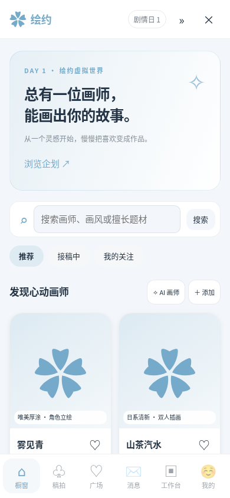

# 绘约 · SillyTavern 约稿模拟扩展 v1.0.0

面向手机竖屏的虚拟约稿平台。六个页面是「橱窗、稿拍、广场、消息、工作台、我的」。所有交易使用虚拟绘币，初始甲方账户赠送 10,000 绘币，不接真实支付。

代码按 SillyTavern 官方 release 1.19.0 的 getContext、generateRaw、消息事件与 Image Generation 命令接口制作。不需要酒馆助手、Node 依赖安装或构建。已做浏览器端功能测试和酒馆接口模拟测试，尚未在用户实际酒馆安装中联调，也未接入真实计费模型验证。

## 在线安装（推荐）

适用于 SillyTavern 1.19.0 及以上版本，电脑和安卓 Termux 使用同一链接。

1. 打开酒馆的「扩展」面板，点击「安装扩展」。
2. 粘贴仓库链接：

   ```text
   https://github.com/yuh123776-cyber/-
   ```

3. 点击安装，完成后刷新酒馆页面，在扩展管理中确认「绘约 · 沉浸式约稿平台」已启用。
4. 点击右下角「✿ 绘约」，或在扩展设置中点击「打开绘约」，也可以输入命令 `/huiyue`。

无需解压、移动文件、安装 npm 依赖或构建。仓库根目录直接包含 `manifest.json` 和全部运行文件，内置安装器可以直接读取。

安装后即可使用本地模拟、手动上传与文字稿功能。AI 私信和出图需要已有可用的酒馆模型 / Image Generation 配置，或在「我的 → 设置、AI 接口与存档」中设置独立 API。自动生成默认关闭。

更新时在酒馆扩展管理中点击检查更新 / 更新，然后刷新页面。



## 手动安装（备用）

1. 停止酒馆，解压安装包，得到 `huiyue` 文件夹。
2. 将整个文件夹放进**酒馆服务所在机器**的以下目录：

   ```text
   SillyTavern/
     public/
       scripts/
         extensions/
           third-party/
             huiyue/
               manifest.json
               index.js
               core.js
               storage.js
               api.js
               bridge.js
               style.css
               ...
   ```

   如果 `third-party` 不存在，可以新建。确认 `manifest.json` 直接位于 `huiyue` 内，避免套两层同名文件夹。

3. 重启酒馆，刷新浏览器；若旧缓存仍存在，请强制刷新。在扩展管理中确认「绘约 · 沉浸式约稿平台」已启用。
4. 点击右下角 `✿ 绘约`，或在扩展设置中点击「打开绘约」。也可发送 `/huiyue`。

Termux 默认酒馆位置通常是 `~/SillyTavern`，实际以你自己的安装路径为准。下载文件一般先在安卓 Download 中，首次让 Termux 访问共享存储可能需要运行 `termux-setup-storage` 并授予系统权限。之后使用文件管理器或 Termux 的复制命令，把解压后的 `huiyue` 放入上述目录。

如果你是在手机访问电脑上的酒馆，只需在电脑的酒馆目录安装一次。不要在手机本地再安装一份。手动安装时使用 ZIP；在线安装时填写上面的 GitHub 仓库链接。

高级用户也可按自己的多用户配置放到 `data/<用户句柄>/extensions/huiyue`；不要同时在两个目录安装同一扩展。

## 先体验一轮：不需要 API

1. 在橱窗选择画师 → 查看主页 → 发起委托。
2. 写清需求、价格与工期；创建订单后再点「确认并托管付款」。报价必须位于画师设置的区间内。
3. 点顶部 `»` 推进剧情 1、3 或 7 天。没有现实计时，关闭页面不会改变日期。
4. 到达阶段节点后，私信与工作板会出现「草稿 V1」等稿件气泡。每个阶段需要验收，不会因为一次推进很多天而跳过验收。
5. 没有 API 时，直接点「上传图片」，或「编辑文字稿说明」使用文字稿模式，然后验收。
6. 修改流程会增加版本，原图继续保留。给已有图片的版本再上传也会新建版本。每版都可下载原文件。
7. 完成草稿、线稿、上色与成稿的验收后，留下合作评价。

默认三个画师使用原创文字人设与图标占位，不附带他人作品图片。可以自行上传头像和作品，或用 AI 生成更多画师资料。未接模型时，可以使用「手动扮演对方」进行私信。

## API 配置与分阶段生成

进入「我的 → 设置、AI 接口与存档」。三个服务分别设置：

| 服务 | 酒馆模式 | 独立模式 |
| --- | --- | --- |
| AI 私信 / 人物生成 | 酒馆当前文本模型 | OpenAI 兼容 `/chat/completions` |
| 提示词 AI | 酒馆当前文本模型，使用单独提示词模板 | 独立根地址、模型与 Key |
| 图片 AI | 酒馆自带 Image Generation 扩展 | OpenAI 兼容 `/images/generations` |

独立 API 根地址示例是 `https://服务商域名/v1`，不要重复填写 `/chat/completions`。独立接口由浏览器直接请求，因此服务必须允许网页跨域访问；电脑或安卓遇到 CORS 或 HTTPS/HTTP 混合内容问题时，优先用酒馆模式。

密钥仅保存在当前页面内存，关闭或刷新页面后需重新输入，不写入 IndexedDB 或导出存档。不主动保存密钥，但浏览器/服务本身的日志行为由其配置决定。

「自动生成提示词」「自动生成图片」是两个独立开关，默认均关闭。工作板的「本订单自动化」可对单个订单选择跟随全局、自动或手动：

- 都关闭：手动点「生成提示词」→ 可编辑 → 手动点「生成图片」。也可以直接上传，跳过所有 AI。
- 只开提示词：新占位会自动整理提示词，出图由你点击。
- 只开图片：手动生成或编辑好提示词后自动出图。
- 都开启：新占位自动执行两步；可以放弃结果或上传自己的图。

开关只作用于之后的新占位和当前执行链，不会因为打开旧页面、刷新、恢复存档而自动补发请求。聊天同步确认产生的占位也不会自动触发 API，避免聊天一句话就意外花费额度。

气泡主按钮随状态变化：生成提示词 → 生成中 → 生成图片 → 绘制中 → 查看稿件 / 下载；失败可重试。手动上传始终可用。上传到正在生成的占位后，迟到的返回结果会被丢弃，不覆盖上传图片。「放弃本次结果」不保证远端生成停止或取消计费。

图片修改不是自动局部重绘：修改版保留上一版提示词、负向提示词、种子与参数记录，但是否能复现构图取决于模型和服务。当前通用图片调用属于文生图，未实现跨服务统一参考图、蒙版与 img2img；需要精准修改时可使用外部绘图工具后上传修改稿。

## 尽可能接更多生图 AI

优先在酒馆的 **Image Generation** 中选来源、模型和服务密钥，然后在绘约选择「使用酒馆当前图片扩展」。这样可以使用当前酒馆所支持的 NovelAI、Stable Diffusion、ComfyUI 以及其他图片来源，具体以你的酒馆界面为准。绘约不会逐家重复实现酒馆已有的认证方式。

独立模式支持 OpenAI 兼容的图片接口，读取 `data[0].b64_json` 或 `data[0].url`。不同服务可能要求特定尺寸、不同参数或跨域权限；不是所有标注“兼容”的服务都支持图片生成端点。通用接口不传 seed、CFG、steps；这些只作为参考记录，真实支持取决于服务。

对于其他协议，已提供自定义适配器注册入口，见 `ADAPTERS.md`。这是一种可扩展架构，不代表未经适配的所有 AI 服务已经可以直接连接。

## 双身份、稿拍与广场

- 在「我的」切换甲方 / 画师。第一次启用画师身份会有提示并收到一份模拟客户委托；后续可在画师工作台点「模拟客户」。客户是本地模拟人物，不是真实用户。
- 两个身份有独立 ID、资料、钱包、私信和美化。设置中的「共用」开关可让后续资料编辑共用；共享美化时采用世界的公共外观。
- 画师委托的款项由虚拟客户托管，完成最后验收才计入画师钱包。「模拟客户验收 / 提出修改」由你控制。
- 稿拍支持成稿、OC 人设、画师档期。成稿和 OC 需要图片；档期可只写文字。出价会预留绘币，被超价时退回；剧情日期到达后结算。
- 模拟 NPC 可随机竞价，也可能出现延期和画师生活动态；可在设置中关闭随机事件。
- 档期成交代表购买档期优先权，画费另行协商，不等于已经购买一张成稿。可指定画师后另建委托。
- 企划在橱窗中有独立入口，支持发布需求、征集符合报价与接稿条件的虚拟应征、邀请画师创建委托。
- 广场可以按稿件 / 生活 / 灵感 / 公告筛选，发布文字与图片、点赞、评论。画师动态可用本地模板或真实文本 AI 生成。

## 当前聊天、角色卡与世界书

1. 先在酒馆打开角色聊天；在绘约的画师主页选择「关联当前角色」。原角色卡不会改写。已关联人设在 AI 私信中优先于随机生成资料。
2. 「我的 → 角色关联与剧情同步」有两个独立开关：监听交稿话语、注入平台状态摘要。默认都关闭。
3. 监听仅对已关联角色生效，用有限中文规则识别草稿 / 线稿 / 上色 / 成稿的提交话语；**不是理解任意剧情的通用智能体**。
4. 识别后在同步日志中出现候选。选择对应的绘制中订单并确认，才添加稿件气泡；多个订单不会由程序猜测归属。
5. 确认后的占位如果尚未上传、生成或验收，可从日志撤销；已使用版本会阻止撤销，保护原图与状态。
6. 开启摘要注入时，最近平台状态会通过酒馆扩展提示参与后续生成，不改写原始聊天消息。原聊天旁的「打开已同步稿件」是附加界面按钮。
7. NPC 提取会读取当前角色卡及其直接关联世界书的文字，用私信 AI 提取最多 12 个候选，再由你勾选添加。不是遍历所有全局世界书，人物遗漏或误识别需要手动修正。

「绑定 / 打开当前聊天世界」会创建这个聊天专属的空白绘约世界。全局独立世界仍保留，可点「打开独立世界」返回。此功能不是把当前世界复制进聊天。聊天元数据只保存世界 ID，大图片在浏览器数据库中。

## 存档、原图与跨设备

- 使用 IndexedDB 保存世界 JSON 与图片 Blob；原图不会为了存储而重新压缩。PNG、JPEG、WebP、GIF、AVIF、BMP 均可，单图上限 40 MB。
- 浏览器清理站点数据、换端口、换域名、换浏览器都会影响存档可见性。请定期使用「导出完整存档」。
- 完整存档是包含 base64 原文件的 JSON，包含头像、背景、作品、稿件和拍品；恢复时重新映射图片 ID，不覆盖其他世界图片。
- JSON 因 base64 会比原图总量大约多三分之一，恢复文件上限 300 MB。大量高分辨率稿件建议按订单分别导出。
- 「导出订单稿件包」产生可独立恢复浏览的单订单存档，不自动合并到当前世界；恢复前务必先备份当前世界。
- 手机与电脑用相同酒馆，也仍是各自浏览器数据库。跨设备时在一端导出完整存档，在另一端导入。没有实现云同步。

## 独立体验 / 开发

不能通过双击 `preview.html` 的 `file://` 方式运行模块。可以在电脑有 Python 时从本目录运行：

```bash
python3 -m http.server 8765 --bind 127.0.0.1
```

然后访问 `http://127.0.0.1:8765/preview.html`。这是实际使用同一套逻辑的独立体验入口，支持本地存档、上传、订单、稿拍与双身份；酒馆模型、角色和消息接口只在酒馆内可用，独立模式也可以配置允许 CORS 的 API。

测试：`npm test`、`npm run check`。完整浏览器验证：先启动上述静态服务，再运行 `python3 tests/browser.py`，需要 Python Playwright 与 Chromium。图片、对话接口测试使用模拟返回，不会产生 API 费用。详细验证范围见 `TESTING.md`。
